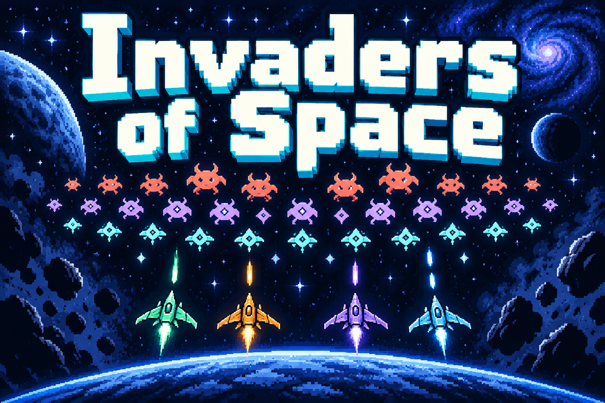
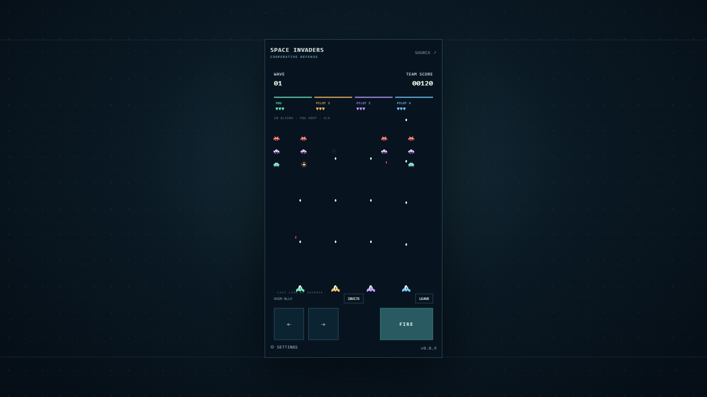

# Invaders of Space

[](docs/game-branding.md)

A pixel-art invasion game for one to four pilots. Hold the line against descending alien waves, share the sky, and survive on three personal lives.



## Live Demo

[Play Invaders of Space](https://samuelasherrivello.github.io/babylon-lite-invaders-of-space-multiplayer/) · [Game release v0.0.9](https://github.com/SamuelAsherRivello/babylon-lite-invaders-of-space-multiplayer/releases/tag/v0.0.9)

One to four players, with the participant host simulating the world through the existing free Vercel Hobby relay. Requires WebGPU. [Verification and hosting limits](docs/verification.md).

## Play

Create a private room, copy its invite link, and start the defense. You can start solo; up to three friends can join during a wave. The four-character code is public invitation information. Your browser keeps a separate private recovery token.

| Action | Keyboard | Touch |
| --- | --- | --- |
| Move | A / D or left / right arrows | Hold either direction |
| Fire | Space | Hold FIRE |
| Settings | Settings button | Settings button |
| Fullscreen | F | Settings checkbox |

Settings release your controls while the shared game continues. Moving and firing simultaneously works with independent touch pointers. There is no sound or music; `?mute=true` is safe for silent testing.

Wave one has three rows of six one-hit aliens. Later waves gain armor, movement speed, and more dangerous firing patterns. Clear every alien to advance. Aliens never fracture. Friendly fire is disabled. If the formation reaches the defense line, the team loses immediately.

Each pilot has three lives across all waves. A third death makes that pilot a spectator while survivors continue. When the whole connected team is eliminated, or the line is breached, the results remain for five seconds. Everyone then restarts together at wave one with three lives.

## Development

Use Node.js 24 and run commands from the repository root:

```sh
npm ci
npm test
npm run dev
npm run build
```

Vite serves the app beneath `/babylon-lite-space-invaders-clone/`; the production output is `space-invaders/dist/`. The checked-in Release workflow builds and tests before tagging. The Pages workflow publishes this output and root `version.txt`.

## Multiplayer

The host browser simulates the world at 60 Hz. The [shared Colyseus server](https://github.com/SamuelAsherRivello/rmc-colyseus-multiplayer-server) handles private admission, ordered actions, checkpoints, and host election. It does not simulate movement, combat, lives, or waves. Every pilot predicts local movement; guests interpolate remote snapshots. Authoritative outcomes always come from the participant host.

The game pins [shared client v0.9.12](https://github.com/SamuelAsherRivello/rmc-colyseus-multiplayer-server/releases/tag/v0.9.12) through its exact release tarball and lockfile integrity. The production relay is `https://rmc-colyseus-multiplayer-server.vercel.app`. An optional `VITE_MULTIPLAYER_ENDPOINT` override accepts a secure relay origin; insecure HTTP is restricted to local development origins.

Intentional departure frees a seat. A dropped connection reserves it for fifteen seconds. Rejoining with the private token restores the same life record, including elimination; it does not grant extra lives. Spectators occupy a seat and can host the simulation. Browser storage loss loses anonymous identity proof. Rooms expire fifteen seconds after the last connection leaves.

Host departure or missed heartbeats elects a successor, which restores the committed world and pending ordered actions before resuming. Hidden tabs yield host eligibility. A missing checkpoint or exhausted journal produces a visible recovery error. Rejoining an expired room requires creating a new room.

Hosting uses the existing **free Vercel Hobby plan only**. Process-local rooms are temporary, with a 300-second function ceiling. Participant-host migration cannot recover a lost backend process. The release requires a public four-minute session check; longer continuity and cross-instance persistence are not promised.

## Graphics and Assets

Use current Chrome or Edge with WebGPU and graphics acceleration enabled. Unsupported browsers show a useful graphics error and retry control. Babylon Lite renders an original 320×576 portrait arena through the Pixel Perfect entry point; there is no fallback renderer.

Integer CSS scaling preserves the logical pixel grid where space permits. Small windows use proportional fractional fit. Fractional device pixel ratios can map CSS pixels unevenly to physical pixels. Camera framing and world bounds stay fixed through resize, fullscreen, and browser zoom.

The ships, alien animation frames, shots, stars, armor, and hit effects are original authored pixel shapes. Regenerate the atlas with `node scripts/generate-art.mjs`. The [Space Invaders reference](https://en.wikipedia.org/wiki/Space_Invaders) informs descending-formation gameplay; no reference artwork or audio is copied.

## Project Details

- [Game design](docs/game-design.md) describes rules, presentation, and multiplayer responsibilities.
- [Completed creation template](docs/game-creation-brief.md) records the brief used for this game.
- [Verification evidence](docs/verification.md) includes reproducible browser checks and disclosed device coverage.
- [Template delivery audit](docs/template-audit.md) records checklist outcomes.
- [Template and shared-skills provenance](docs/skills-import.md) records the source revisions and workflow setup.
- `space-invaders/src/content/game/` contains deterministic rules, input, session coordination, and the Babylon Lite renderer.
- `space-invaders/test/` contains rule, input, session, shell, and rendering-policy checks.

## Original AI Prompt

Original prompt source URL: unavailable and unverified. The actual initiating request is preserved below.

<details>
<summary>Original request and supplied template</summary>

```text
update this template and fully populate it for a multiplayer 2d pixel perfect game of [https://en.wikipedia.org/wiki/Space_Invaders](https://en.wikipedia.org/wiki/Space_Invaders)

players can hot join and drop and the world is owned and simulated by the host with asteroids and a wave number. each wave is more complex with asteroids that require more shots before fracturing and each has higher chance to fracture in more pieces. level one is 3 asteroids each that fracture in 2 and each of those destroy without fracturing. when all asteroids are gone the wave advances when the player dies 3 times across any/all waves the game is over. if one player lives longer, the other can spectate until the game restarts at wave one with both of them after both die. the game can be playced with 1/2/3/4 players

Its space invaders not asteroids. So side view of decending aliens, but 4 players and coop against the incming aliens and in waves.

$ai-skills-create-game

- Title: [Enter the Gungeon Clone]
- Type: [Multiplayer, online cooperative, 2–4 players. All human players cooperate on the same team.]
- World and camera:
  - [Create one 2D level approximately twice the viewport width and twice its height, giving it about four times the area of one screen.]
  - [The level may be tile-based or use freely placed artwork and geometry.]
  - [Use a top-down orthographic camera that smoothly follows the local player and stays within the level boundaries.]
- Core loop: [Cooperate to survive increasingly difficult enemy waves, dodge bullet patterns, collect loot, and choose weapon upgrades between waves. Defeat a boss every five waves. The run ends when the entire team is down.]
- Controls: [WASD movement, mouse aiming, left-click shooting, and Space to dodge roll with a short cooldown and brief invulnerability.]
- Cooperative mechanics:
  - [Create or join a room using a shareable room code, then ready up together.]
  - [Revive downed teammates, share upgrade rewards, and disable friendly fire.]
  - [Scale enemy counts and difficulty with the number of active players.]
  - [Show directional indicators for teammates outside the local camera view.]
- Look and feel:
  - [Original pixel-art dungeon scenery with stone floors, destructible props, and readable cover.]
  - [Distinct player colors, expressive enemies, bright projectiles, punchy muzzle flashes, and clear hit feedback.]
  - [Keep enemy bullets visually distinct from friendly shots. Show player health, teammate status, current wave, remaining enemies, and dodge cooldown.]
- Gameplay requirements:
  - [Include three starting weapons with distinct firing patterns and meaningful upgrades.]
  - [Include enemies that chase, fire aimed shots, and emit radial bullet patterns.]
  - [Provide short breaks between waves for upgrades and a team restart option after defeat.]
- Multiplayer server and smoothness:
  - [Use https://github.com/SamuelAsherRivello/rmc-colyseus-multiplayer-server or my writable fork: <fork URL, if applicable>.]
  - [Automatically update the selected server repository with the room logic and synchronized state required by this game.]
  - [Make the server authoritative for movement validation, combat, enemy spawning, damage, loot, revives, and wave progression.]
  - [Use supported Colyseus prediction features where available, or implement suitable client-side prediction, server reconciliation, and interpolation.]
  - [Respond immediately to local movement and dodge inputs. Smooth reconciliation corrections and drive the camera from the predicted local character position to avoid visible jitter.]
  - [Interpolate remote players and enemies. Use immediate local animations, muzzle flashes, and cosmetic effects while reconciling gameplay outcomes with the server.]
  - [Use deterministic projectile motion or other bandwidth-efficient synchronization where appropriate.]
  - [Prioritize a smooth, consistent experience for every player over action density. If synchronization struggles, reduce concurrent bullets, enemies, spawn rates, and firing rates.]
  - [Handle disconnects and reconnects gracefully.]
  - [Verify with at least two browser clients, including simulated latency and jitter. Check responsive local movement, stable camera tracking, smooth remote motion, and consistent combat outcomes.]
- Inspiration links:
  - [https://store.steampowered.com/app/311690/Enter_the_Gungeon/]
- Inspiration screenshots: [Attach reference screenshots here.]
- Originality requirement: [Keep the requested project title, but create original artwork, sounds, characters, weapons, UI, and level layouts; use the reference only for gameplay and visual inspiration.]
```

</details>

<details>
<summary>Consequential follow-ups</summary>

```text
we use only a relay server so the host simulates

stop there.

Now read the $ai-skills-create-game skill and prepare a $openspec-propose about how you will use the template and multiplayer server to meet the needs of the requested prompt. This allows for propose to think more heavily before implemtation.

You have GitHub access and the multiplayer server has the vercel credentials. there is no reason to stop for any reason until the game is done, and shipped to the readme as a live demo.

you are required to use the free plan of vercel. stop asking for alternatives
```

Interview answers selected option 1: wave one has three rows of six one-hit
aliens, with later armor/speed/firing complexity and no splitting; new players
get three lives, while returning players keep remaining lives/elimination; an
alien breach ends the team run and the shared restart returns to wave one.
Earlier interview answers selected automatic host migration preserving the run.

</details>

Interpretation: The Space Invaders correction replaces contradictory asteroid
fracturing, dungeon camera, dodge, revive, loot and boss examples. The title is
Space Invaders. All visuals are original. A fixed arena, personal life budgets,
spectating and participant-hosted simulation implement the clarified request.


## Credits


### 💡 Contributors


- Samuel Asher Rivello - Over 25 years of game development XP (2026)

### 💡 Contact


- [LinkedIn.com/in/SamuelAsherRivello](https://Linkedin.com/in/SamuelAsherRivello) ⭐ 
- [GitHub.com/SamuelAsherRivello](https://github.com/SamuelAsherRivello/)
- [Twitter.com/srivello](https://twitter.com/srivello/)
- Resume / Portfolio: [SamuelAsherRivello.com](http://www.SamuelAsherRivello.com)


### 💡 License


- Provided as-is under the [MIT License](LICENSE).

- Copyright © 2026 Rivello Multimedia Consulting, LLC.
